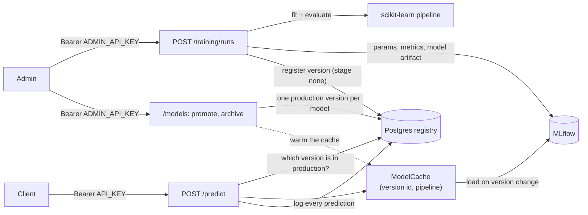
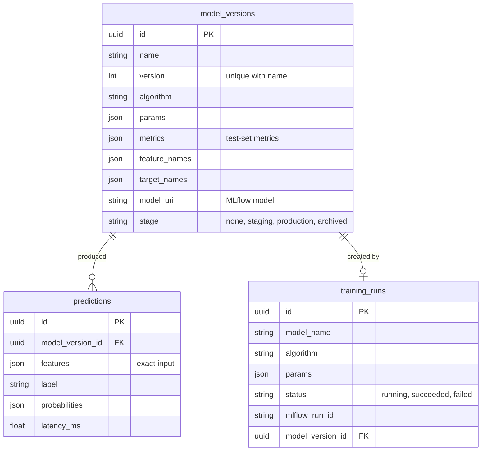

# ml-model-serving

Train, version, promote and serve a scikit-learn classifier behind an API.

- **Training:** fits a pipeline on the Wisconsin breast cancer dataset that ships inside scikit-learn, so there are no downloads.
- **Tracking:** each run's parameters, test-set metrics and model artifact go to **MLflow**.
- **Registry:** a model registry in Postgres decides which version is in production.
- **Serving:** `/predict` serves that version from an in-memory cache that swaps automatically when a new version is promoted. Every prediction is logged with its exact input.

**What runs where:** everything runs locally with Docker: Postgres, an MLflow tracking server (UI on <http://localhost:5001>) and the API. Tests use a throwaway local MLflow store, so no tracking server is needed for them. The project is **not deployed**.

**Stack:** Python 3.12, FastAPI, SQLAlchemy 2 (async), Alembic, Pydantic v2, scikit-learn, MLflow 3, pytest, ruff, uv.

## Architecture



Each module has the same shape: `routes.py → controller.py → service.py → repository.py`, plus `schemas.py` (Pydantic) and `models.py` (SQLAlchemy). The ML code is kept in plain functions that know nothing about HTTP or the database (`modules/training/trainer.py`). MLflow is reached only through `modules/training/tracker.py`.

```
app/
  core/        settings, errors + handlers, async engine + Database.transaction(), base repository,
               pagination, bearer-key auth, schema base (camelCase JSON)
  modules/
    training/    trainer.py (dataset, pipeline factory, metrics), tracker.py (MLflow), runs API
    models/      registry: versions, stages, promote / archive
    predictions/ model_cache.py, validation, /predict, prediction log
  container.py composition root          main.py  app factory
migrations/    Alembic (includes the "one production version per model" partial unique index)
scripts/       start_with_secrets.py, train.py (CLI), example_request.py
tests/         unit/ and integration/ (Postgres + local MLflow store)
```

## Data model



## Run it

Requires Docker.

```bash
cp .env.example .env
docker compose up --build
```

The API is on <http://localhost:8000> (interactive docs at `/docs`) and the MLflow UI on <http://localhost:5001>. Postgres is exposed on host port **5444**.

```bash
ADMIN="Authorization: Bearer $(grep ^ADMIN_API_KEY .env | cut -d= -f2)"
KEY="Authorization: Bearer $(grep ^API_KEY .env | cut -d= -f2)"

# Train a version (metrics come back in the response and appear in MLflow)
VERSION=$(curl -s localhost:8000/training/runs -H "$ADMIN" -H 'Content-Type: application/json' \
  -d '{"algorithm":"random_forest","params":{"n_estimators":200}}' | jq -r .data.modelVersion.id)

# Promote it, then predict with two real rows from the dataset
curl -s -X POST localhost:8000/models/$VERSION/promote -H "$ADMIN" -H 'Content-Type: application/json' \
  -d '{"stage":"production"}'
uv run python -m scripts.example_request 2 > body.json
curl -s localhost:8000/predict -H "$KEY" -H 'Content-Type: application/json' -d @body.json | jq .data
```

The same training is available from the command line: `uv run python -m scripts.train --algorithm logistic_regression --param C=0.5 --promote`.

### Tests and lint

```bash
docker compose up -d postgres     # tests use a separate ml_test database, created automatically
uv sync
uv run ruff check . && uv run ruff format --check .
uv run pytest
```

## Endpoints

Every JSON response uses one envelope: `{ "data": … }`, plus `"meta": { page, pageSize, total, totalPages }` on lists. Errors are `{ "error": { "code", "message", "details"? } }`. Lists take `?page=&pageSize=`.

| Method | Path | Auth | Notes |
|---|---|---|---|
| GET | `/health` | | |
| POST | `/training/runs` | admin | `{name?, algorithm, params, testSize, randomState}`; returns the run and new version |
| GET | `/training/runs` · `/training/runs/{id}` | admin | Run history, including failed runs and their error |
| GET | `/models` | admin | `?name=&stage=` |
| GET · PATCH · DELETE | `/models/{id}` | admin | PATCH sets the description; DELETE refuses the production version |
| POST | `/models/{id}/promote` | admin | `{stage: "staging" or "production"}`; production archives the previous one |
| POST | `/models/{id}/archive` | admin | |
| POST | `/predict` | API key | `{model?, instances: [{feature: number}]}`, up to `MAX_BATCH_SIZE` instances |
| GET | `/predictions` · `/predictions/{id}` | API key | `?modelVersionId=` |

**Algorithms and hyperparameters** (validated; unknown keys are rejected):

| Algorithm | Hyperparameters |
|---|---|
| `logistic_regression` | `C` (default 1.0), `max_iter` (default 1000) |
| `random_forest` | `n_estimators` (default 100), `max_depth` (default none) |

## Key design decisions

**MLflow for experiments, Postgres for decisions.** MLflow records every run: parameters, metrics and the model artifact. The registry in Postgres holds the business state: which version is staging or production, its description, and which predictions it served. Promotion is then an ordinary transaction with constraints, and the prediction log can reference versions with a foreign key.

**Exactly one production version, enforced twice.** `promote` locks the current production row (`SELECT … FOR UPDATE`), archives it and promotes the new version in one transaction. A partial unique index (`UNIQUE (name) WHERE stage = 'production'`) means the database itself refuses a second production version, even if two promotions race. A test writes a second production row directly with SQL and gets an `IntegrityError`.

**Serving cache that notices promotions anywhere** (`modules/predictions/model_cache.py`). Each prediction reads the current production version id, a single indexed query, and compares it with the cached one. If they differ, the new pipeline is loaded from MLflow and swapped in. So promoting through any API instance is picked up by every instance on its next prediction. A test promotes by changing the database directly, behind the cache's back. Promoting through this instance also loads the model immediately, so the first prediction doesn't wait. Concurrent first requests share one load.

**Strict input validation against the model's own features.** Each instance must have exactly the feature names the version was trained on, and every value must be a finite number. Numeric strings like `"17.99"` are rejected rather than converted. Errors list the missing, unexpected and non-finite fields per instance. Values are passed to the pipeline in training column order, whatever order the request used.

**Honest metrics.** Accuracy, macro precision, macro recall, macro F1 and ROC AUC are computed on a stratified held-out split with a fixed seed, stored on the version and logged to MLflow. Macro averaging avoids silently treating one class as "positive". The README quotes no numbers; they come from running the code.

**Safe model files.** MLflow 3 saves scikit-learn models with skops rather than pickle. skops refuses to load internal types that aren't explicitly trusted, so each algorithm declares the types it needs (`TRUSTED_TYPES` in `trainer.py`), and they're recorded with the model when it's saved.

**Patterns, only where they earn their place.**
- *Singleton:* settings, the database engine, and the loaded model (`ModelCache`).
- *Factory:* `ALGORITHMS` maps an algorithm name to its hyperparameter schema and pipeline builder.
- *Repository:* all database access, through `BaseRepository`.

## Results

Not yet measured, run `uv run python -m scripts.train` (it prints the test-set metrics of the version it registers; they're also visible in the MLflow UI).

## Known limitations

- **Training runs inside the HTTP request.** This dataset trains in seconds; larger jobs would need a background worker and a status endpoint to poll.
- **One dataset.** The trainer is written for the bundled breast cancer data; supporting uploaded datasets would need schema handling that this project doesn't have.
- **Version numbers can collide if two trainings finish together.** The next number comes from `max(version) + 1`; the unique constraint rejects the second one rather than duplicating it, so that training must be retried.
- **Prediction latency covers the model call only.** Logged `latency_ms` is the model call divided by batch size; it doesn't include validation or the database write.
- **Single-instance compose setup.** The MLflow server stores runs in SQLite; a real deployment would use a database backend and object storage.
- **Two static bearer keys.** There are no users or roles.

## Deployment

| File | Purpose |
|---|---|
| `Dockerfile` | Multi-stage build with uv: installs locked production dependencies, then copies the virtualenv and source into a slim image that runs as a non-root user, with a healthcheck on `/health`. |
| `scripts/start_with_secrets.py` | Container entrypoint. With `SECRETS_SOURCE=aws` it loads one JSON secret (`SECRET_ID`) from AWS Secrets Manager into the environment; with `local` it uses `.env`. It fails fast if the secret or a required key (`DATABASE_URL`, `ADMIN_API_KEY`, `API_KEY`) is missing, validates settings, then starts uvicorn. |
| `deploy/ecs-task-definition.json` | ECS Fargate task definition template with `${…}` placeholders for account id, region, image tag, role ARNs, secret id and MLflow tracking URI. |
| `.github/workflows/deploy.yml` | Manual-only (`workflow_dispatch`) workflow. It assumes an AWS role through GitHub OIDC (no stored keys), builds and pushes the image to ECR, fills in the task definition and updates the ECS service. |
| `.github/workflows/ci.yml` | Runs ruff (lint and format check) and pytest against a Postgres service container on every push and pull request. |

Deployment config is provided as a reference. This project has not been deployed.
